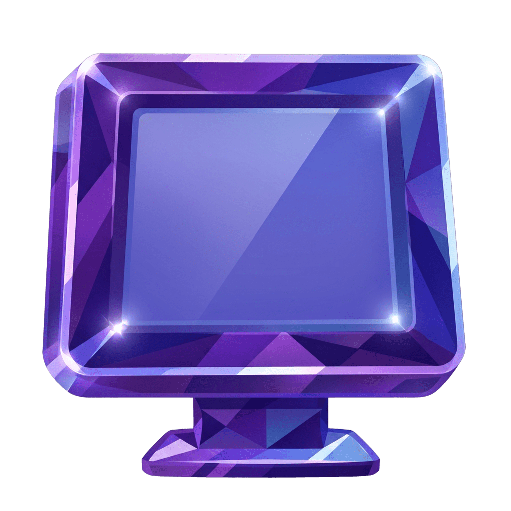

<div align="center">


# Discord Streaming Badge Farming Extension

### Automated browser extension to farm hours for Discord's official Streaming Badge.

**Seamlessly automate 24/7 screen sharing, auto-balance voice rooms, and progress through all 10 Streaming Badge tiers from Newcomer (1h) to Phenomenon (5,000h).**

[](https://github.com/Discord-ID/Discord-Streaming-Badge-Farming-Extension/stargazers)
[](manifest.json)
[](manifest.json)
[](LICENSE)
[](https://discord.gg/idn)
[](#quick-start)

**[Discord Community](https://discord.gg/idn) · [Report Issue](https://github.com/Discord-ID/Discord-Streaming-Badge-Farming-Extension/issues) · [Discussions](https://github.com/Discord-ID/Discord-Streaming-Badge-Farming-Extension/discussions)**

<br />

<a href="https://discord.gg/idn"></a>

<br /><br />

[About the Badge](#about-the-discord-streaming-badge) · [Badge Tiers](#streaming-badge-tiers) · [Quick Start](#quick-start) · [Streaming Dashboard](#streaming-dashboard) · [Supported Rooms](#supported-voice-channels) · [FAQ](#faq) · [License](#license)

</div>

> [!IMPORTANT]
> **Prerequisite to Earn Badge Progress:**
> Discord only logs badge hours if personalization data is enabled on your account.
> 
> Go to **User Settings** → **Data & Privacy** → toggle **ON** `Use data to personalize my Discord experience`.
> 
> Screen sharing time only counts when **at least one other participant** is present in the voice room. The designated farming channels in the **Discord Indonesia** server (`discord.gg/idn`) run 24/7 with active participants for this purpose.

<div align="center">

<br />



<br /><br />

<table aria-label="Discord Indonesia Community">
<tr>
<td align="center" width="420">
  <a href="https://discord.gg/idn">
    <strong>Join the Discord Indonesia Community</strong>
  </a><br />
  <sub>24/7 Badge Farming Voice Channels · Active Screen Share Rooms</sub>
</td>
</tr>
</table>

<br />

</div>

---

## About the Discord Streaming Badge

The **Streaming Badge** is an evolving profile badge awarded by Discord to recognize users who actively share their screen with others. 

Key details:
- **Eligibility**: Time counts whenever you are sharing your screen with **at least one other person** in a voice channel or call.
- **Tracking Window**: Screen sharing activity has been officially counted by Discord since **January 1, 2024**.
- **Badge Evolution**: The badge dynamically evolves into higher-tier visual variants as your cumulative logged streaming hours increase, spanning 10 progressive tiers from 1 hour all the way to 5,000 hours.
- **Delay**: Discord's profile system updates badge progress periodically; recent streaming hours may take a short time to reflect on your profile.

---

## Streaming Badge Tiers

| Badge Icon | Tier Name | Required Streaming Time | Milestone Details |
|:---:|:---|:---:|:---|
|  | **Streaming Newcomer** | **1 Hour** | First milestone of screen sharing logged by Discord |
|  | **Streaming Fledgling** | **5 Hours** | Early streaming stage |
|  | **Streaming Breakout** | **20 Hours** | Regular screen sharing milestone |
|  | **Streaming Standout** | **75 Hours** | Dedicated streamer tier |
|  | **Streaming Trendsetter** | **150 Hours** | Advanced streaming community member |
|  | **Streaming Headliner** | **300 Hours** | Extensive streaming activity |
|  | **Streaming Star** | **500 Hours** | Elite streaming milestone |
|  | **Streaming Sensation** | **1,000 Hours** | 1,000 hours of confirmed screen sharing |
|  | **Streaming Visionary** | **2,000 Hours** | Veteran streamer tier |
|  | **Streaming Phenomenon** | **5,000 Hours** | Maximum tier of the Discord Streaming Badge |

---

## What This Extension Does

Achieving hundreds or thousands of hours manually is tedious and resource-heavy. This extension handles the entire farming process in the background on Discord Web:

1. **Autonomous Room Balancing**: Continuously inspects active badge farming rooms in Discord ID (`discord.gg/idn`) and automatically connects to the room with the fewest occupants (ensuring there is at least one other participant to qualify).
2. **Virtual Screen Share**: Streams a lightweight, offscreen looped video element directly through WebRTC using a universal `getDisplayMedia` polyfill.
3. **Bandwidth & CPU Conservation**: Allows setting stream frame rate to **15 FPS** or **30 FPS** and resolution to **480p**, minimizing CPU, RAM, and network consumption compared to regular screen sharing.
4. **Auto-Restream & Reconnect Loop**: If Discord drops the voice connection or closes the stream, the extension's supervisor loop automatically counts down and rejoins without manual intervention.
5. **Configurable Farming Cycles**: Set streaming duration per session (default: 6 hours) followed by automatic rest cooldowns (default: 5 minutes) before seamlessly resuming.

---

## Quick start

### Desktop Installation (Chrome / Brave / Edge / Opera)

1. **Clone or Download** this repository:
   ```bash
   git clone https://github.com/Discord-ID/Discord-Streaming-Badge-Farming-Extension.git
   ```
   *(Or click **Code** → **Download ZIP** and extract it)*.
2. Open your Chromium-based browser and navigate to `chrome://extensions/`.
3. Enable **Developer mode** using the toggle in the top-right corner.
4. Click **Load unpacked** and select the folder containing `manifest.json`.
5. Open [Discord Web](https://discord.com/channels/@me).
6. Click the **Discord Streaming Badge Farming** icon in your browser toolbar to open the **Streaming Dashboard**!

### Mobile Installation (Android via Kiwi or Lemur Browser)

You can run this extension 24/7 on Android devices without needing a PC:

1. Install **Kiwi Browser** or **Lemur Browser** from the Google Play Store.
2. Open the browser and go to the **Extensions** menu.
3. Turn on **Developer mode**.
4. Tap **Load unpacked** and select the extension folder or zip file.
5. Open [Discord Web](https://discord.com/channels/@me) in **Desktop Site** mode.
6. The extension will automatically initialize and connect to candidate badge rooms!

---

## Streaming Dashboard

Click the extension icon in your browser extensions toolbar while on any `https://discord.com/channels/*` page to toggle the **Streaming Dashboard**.

### 1. Dashboard Tab
- **Status & Counters**: Live streaming status, elapsed duration (`HH:MM:SS`), session target, and next cooldown timer.
- **Channel Balancer Grid**: View real-time occupant counts across all badge rooms. Click **Join** on any channel to switch and pin that room for your session.
- **Quick Controls**: **Stop Streaming** or **Join Streaming** to start/stop manually.

### 2. Settings Tab
- **Auto Join Voice Channel**: Automatically scan and join the optimal voice room on startup.
- **Auto Screenshare (Go Live)**: Automatically start virtual streaming once connected to voice.
- **Auto Reconnect Voice**: Monitor voice connection health and automatically rejoin if disconnected.
- **Stream Quality**: Select between `480p`, `720p`, or `1080p` (480p is recommended for low resource usage).
- **Stream Frame Rate**: Configure `15 FPS`, `30 FPS`, or `60 FPS` (15 or 30 FPS saves CPU & bandwidth).
- **Session Duration & Cooldown**: Customize farming hours (1–24h) and rest cooldown breaks (1–30m).

---

## Supported Voice Channels

Configured for **Discord Indonesia** (`1419245943999692854`):

| Channel Name | Channel Snowflake | Purpose |
|---|---|---|
| `🐝・Badge Farming I` | `1532531180229103626` | 24/7 badge streaming room |
| `🐝・Badge Farming II` | `1562379518864269382` | 24/7 badge streaming room |
| `🐝・Badge Farming III` | `1562514091589898250` | 24/7 badge streaming room |

---

## FAQ

<details>
<summary><strong>How do I open the streaming dashboard?</strong></summary>

Click the **Discord Streaming Badge Farming** extension icon in your browser extensions toolbar while viewing any Discord channel or server (`https://discord.com/channels/*`). The dashboard will smoothly slide open.

</details>

<details>
<summary><strong>Does this extension collect or upload my Discord token or password?</strong></summary>

**No.** The extension never touches, stores, or sends your account credentials, auth tokens, or passwords. It operates entirely client-side inside your browser, reading Discord's already authenticated internal stores.

</details>

<details>
<summary><strong>Why does the dashboard say "Locked (Join Server First)"?</strong></summary>

The designated farming rooms are exclusive to the Discord Indonesia server. You must join the server via [discord.gg/idn](https://discord.gg/idn) to grant your account voice permissions.

</details>

<details>
<summary><strong>Which stream quality and frame rate should I choose?</strong></summary>

For maximum efficiency and minimum CPU usage, **480p @ 15 FPS** or **480p @ 30 FPS** is recommended. Discord badge farming counts streaming duration regardless of whether you stream at 480p 15 FPS or 1080p 60 FPS.

</details>

<details>
<summary><strong>Does the extension keep streaming if I minimize the browser?</strong></summary>

Yes, as long as the Discord tab remains open. Ensure your browser's "Memory Saver" or "Sleeping Tabs" feature does not discard or suspend the Discord tab.

</details>

<details>
<summary><strong>Can I change the video being streamed?</strong></summary>

Yes. You can replace `assets/videostream.mp4` with any lightweight MP4 video of your choice, or configure a custom video URL via `window.discordScreenshare.setVideoUrl("URL")`.

</details>

---

## Star history

<a href="https://www.star-history.com/?repos=Discord-ID%2FDiscord-Streaming-Badge-Farming-Extension&amp;type=date">
  <picture>
    <source media="(prefers-color-scheme: dark)" srcset="https://api.star-history.com/chart?repos=Discord-ID/Discord-Streaming-Badge-Farming-Extension&amp;type=date&amp;theme=dark&amp;legend=top-left" />
    <source media="(prefers-color-scheme: light)" srcset="https://api.star-history.com/chart?repos=Discord-ID/Discord-Streaming-Badge-Farming-Extension&amp;type=date" />
    
  </picture>
</a>

---

## Contributing

Contributions, bug reports, and suggestions are welcome!

1. Fork the repository.
2. Create your feature branch (`git checkout -b feature/amazing-feature`).
3. Commit your changes (`git commit -m "feat: add amazing feature"`).
4. Push to the branch (`git push origin feature/amazing-feature`).
5. Open a **Pull Request** targeting the `development` branch.

---

## Disclaimer

This project is intended strictly for personal automation and educational purposes. Automating user actions on Discord should be conducted responsibly and in compliance with applicable community guidelines and terms of service. The developers assume no responsibility for any misuse.

---

## License

[MIT](LICENSE)

Discord Streaming Badge Farming Extension code is licensed under the MIT License. Discord and all Discord-related branding, trademarks, logos, and Streaming Badge designs are the property of Discord Inc.

This project is an independent open-source tool and is not affiliated with, authorized, maintained, sponsored, or endorsed by Discord Inc. or any of its affiliates. All product and company names are trademarks™ or registered® trademarks of their respective holders; use of them does not imply any affiliation with or endorsement by them. Users are solely responsible for adhering to Discord's Terms of Service and Community Guidelines when utilizing automated tooling.
